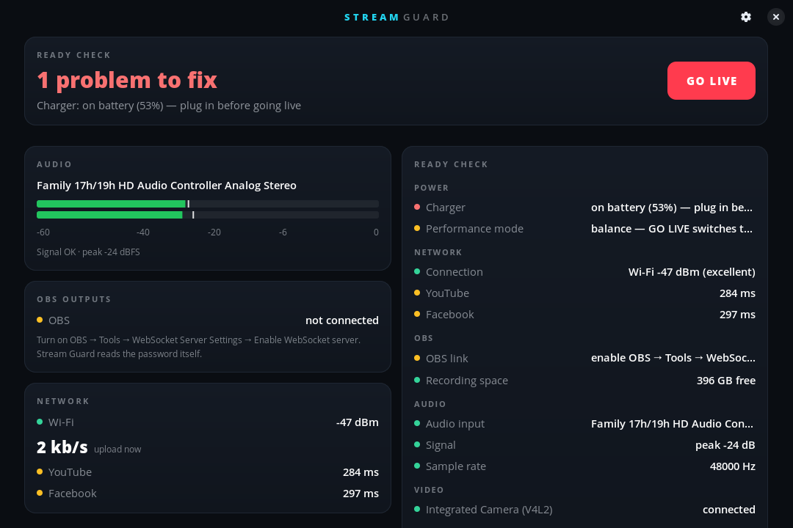

# Stream Guard

[](https://github.com/mishabvibes/streamguard/actions/workflows/tests.yml)
[](LICENSE)

A ready-check and on-air monitor for people who stream live events with OBS on
Linux. Before the show it tells you what's wrong. During the show it watches
your audio, capture devices, network, OBS outputs and laptop, and alerts you
(and your phone) the moment something breaks.

<p align="center"></p>

**Nothing runs in the background.** There is no service and no autostart.
Stream Guard only does anything while its window is open, and it installs per
user without root.

## What it watches

| | Before going live (ready check) | While live (alerts) |
|---|---|---|
| **Audio** | your console/interface is connected, has signal, isn't clipping, PipeWire runs at 48 kHz | **silence for 8 s** (muted channel, pulled cable, console off), clipping, console unplugged |
| **Video** | every capture card you marked is connected; shows its best mode (e.g. 1920×1080 @ 60) | capture card unplugged or lost power |
| **Network** | Ethernet vs Wi-Fi, Wi-Fi signal, reachability and latency of YouTube / Facebook / Twitch / Instagram ingest servers | network down, switched to Wi-Fi/tether, weak signal, platform unreachable |
| **OBS** | WebSocket link works, recording disk space | every output (main stream, multistream plugin targets, SRT, recording): bitrate, **dropped frames**, congestion, reconnecting, **stream stopped**, OBS render lag, encoder overload, OBS closed |
| **Laptop** | on charger, CPU/GPU temperature | charger unplugged, overheating, recording disk almost full |

**GO LIVE** starts the stream in OBS (plus an optional backup recording),
turns on alerts, blocks sleep and screen lock, and switches the laptop to
Performance mode if [lpowerd](https://github.com/mishabvibes/lpowerd) is
installed. Starting the stream from OBS itself starts a session too.
**END STREAM** asks whether to stop the stream in OBS or only stop watching,
puts everything back, and saves a report to
`~/Documents/StreamGuard/` (Markdown plus JSON): duration, data sent and
average/peak bitrate per output, max temperatures, weakest Wi-Fi signal, and
every alert with its time and how long it lasted.

### Alerts

- **In the window:** a red/amber banner per problem.
- **Desktop notifications.**
- **Phone:** install the free [ntfy](https://ntfy.sh) app, subscribe to a topic
  name only you know, and enter it in Settings → Alerts. Critical alerts arrive
  as urgent pushes, so you hear about a dead mic even from the back of the hall.
- **Sound (opt-in):** pick an output OBS doesn't capture, such as your
  headphones. Otherwise the alarm could end up on the stream, which is why it's
  off by default.

## Install

```bash
git clone https://github.com/mishabvibes/streamguard.git
cd streamguard
./install.sh            # no sudo; installs to ~/.local
```

Needs Python 3, GTK 4 + libadwaita, GStreamer (`level` element from
plugins-good), libsoup 3 and dbus-python. All of these ship with Pop!_OS /
Ubuntu 24.04. The installer tells you the exact `apt` command if one is missing.

Uninstall: `./install.sh --uninstall`.

## First run

1. **OBS:** *Tools → WebSocket Server Settings → Enable WebSocket server.*
   Stream Guard reads the port and password from OBS's own config, both native
   and Flatpak, so there is nothing to copy.
2. **Settings → Devices:** pick your mixer/audio interface and switch on the
   capture cards that must stay connected.
3. **Settings → Alerts:** optionally add your ntfy topic and press *Test*.

## How it works

```
GStreamer DeviceMonitor ──▶ hotplug of capture cards / audio interfaces
GStreamer level element ──▶ per-channel peak meter (PipeWire lets it share the input with OBS)
OBS WebSocket v5 (libsoup) ─▶ GetStats + per-output GetOutputStatus every 2 s
/proc/net/route, /proc/net/wireless, /sys/class/net ──▶ link type, signal, upload rate
TCP connect to ingest servers every 15 s ──▶ reachability + latency (no root needed)
hwmon, nvidia-smi, power_supply ──▶ temperatures, GPU encoder load, charger
logind Inhibit ──▶ no sleep / screen lock while live
        │
        ▼
rules.py (pure, unit-tested): silence/clip detectors, dropped-frame rates, ready check
        │
        ▼
alerts.py: window banner · desktop notification · ntfy push · optional sound
```

Stream Guard never changes OBS settings and never touches your audio routing.

## Development

```bash
python3 -m unittest -v tests/test_streamguard.py
./bin/streamguard          # run from the source tree
```

## License

Copyright (C) 2026 mishabvibes. GPL-3.0-or-later, see [LICENSE](LICENSE).
